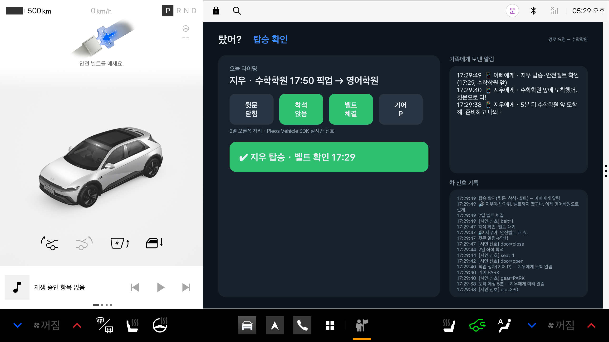

# 탔어? — 학원 라이딩 탑승·안전벨트 확인 앱 (Pleos Connect)

운전 중이라 휴대폰을 못 만지는 부모 대신, **차가 아이의 탑승과 안전벨트 체결을 확인해 가족에게 「탔어」를 알려 주는** 학원 라이딩 앱입니다.
현대자동차그룹 차량용 앱 개발 공모전(2026) 출품작입니다.



## 무엇을 하나

| 기능 | 판단 근거(차량 신호) | 결과 |
|---|---|---|
| 도착 5분 전 미리 알림 | NaviHelper 주행 정보(도착 예정 시간) | 아이에게 「5분 뒤 도착」 |
| 탑승·벨트 확인 | 정차 중 2열 뒷문 열림→닫힘 + 2열 착석 + 2열 벨트 체결 | 다른 보호자에게 「탑승·안전벨트 확인」 |
| 출발 전 벨트 지킴이 | 착석했는데 벨트 미체결 상태에서 기어 D | 음성 + 빨간 화면 경고 |
| 하차 확인 | 다음 학원 정차, 뒷문 열림→닫힘 + 좌석 비움 | 「하차 확인」 |
| 아이 구간 편안한 길 | 탑승 후 경로 옵션 `COMFORTABLE` | 급회전·급정거가 적은 경로 요청 |

판정 규칙은 `RideEngine.kt` 한 곳에 모았습니다(화면·SDK 코드와 분리).

## 실행 방법

1. Android Studio에서 이 저장소를 엽니다(Gradle 8.11.1, AGP 8.7.3, Kotlin 1.9.25, JDK 17).
2. Pleos Connect 에뮬레이터를 띄웁니다(아래 테스트 환경).
3. `apk/` 폴더의 release APK를 설치하거나 `./gradlew assembleRelease` 후 설치합니다.
   ```bash
   adb install -r -g apk/tasseo_tasseo-ride_release.apk
   adb shell am start -n kr.tasseo.ride/.MainActivity
   ```
4. 화면의 「지우 데리러 출발」을 누르면 라이딩이 시작됩니다.

### 시연 신호(에뮬레이터 전용)

에뮬레이터는 user 빌드라 `car_service inject-vhal-event` 가 막혀 있고, Vehicle SDK에서 값을 바꿀 수 있는 제어 API는 도어(`setDoorPosition`)뿐입니다.
그래서 착석·벨트·기어 값은 앱이 받는 **시연 신호(브로드캐스트)**로 같은 판정 엔진에 넣습니다. 화면 「차 신호 기록」에 `[시연 신호]`로 표시됩니다.
실제 SDK 신호는 `CarBridge.kt` 리스너로 들어옵니다(에뮬레이터에서 기어 P·2열 착석 수신 확인).

```bash
adb shell am broadcast -a kr.tasseo.ride.SIM --es sig seat --es val 1   # 착석
adb shell am broadcast -a kr.tasseo.ride.SIM --es sig belt --es val 1   # 벨트 체결
adb shell am broadcast -a kr.tasseo.ride.SIM --es sig gear --es val DRIVE
ADB="adb -s <기기>" bash tools/demo_scenario.sh 4                      # 시연 한 바퀴
```

## 테스트 환경

| 항목 | 값 |
|---|---|
| 에뮬레이터 | **Pleos Connect v2.1.0** (System Image API 34, x86_64, `crp_car_emulator`) |
| 화면 규격 | **2560 × 1440**, 160dpi (앱은 오른쪽 앱 영역에 표시) |
| 최소 SDK | API 28 |
| 사용 SDK | `ai.pleos.playground:Vehicle:2.3.2`, `ai.pleos.playground:NaviHelper:3.0.5` |
| 필요한 설정 | 권한 `pleos.car.permission.CAR_DOORS`·`CAR_SEATS`·`CAR_SAFETY`·`CAR_DRIVE`·`NAVI_ROUTE_SEARCH`·`NAVI_ROUTE` (`adb install -g` 로 부여) |

## APK

- 위치: [`apk/tasseo_tasseo-ride_release.apk`](apk/tasseo_tasseo-ride_release.apk) (release 빌드, 시연용 디버그 키 서명)
- 시연 영상: [`docs/tasseo_demo.mp4`](docs/tasseo_demo.mp4)

## 구조

```
app/src/main/java/kr/tasseo/ride/
  RideEngine.kt   판정 엔진(탑승·벨트·하차·도착 예정) — 차량 신호 → 음성·가족 알림
  CarBridge.kt    Pleos Vehicle SDK·NaviHelper SDK 연결
  MainActivity.kt 운전자 화면(큰 글씨 한 줄 + 신호 4칸, 조작은 출발 버튼 하나)
docs/gleo_app_schema.json  Gleo Interface(App Schema) 함수 정의안 — 「Gleo, 지우 탔어?」
tools/demo_scenario.sh     에뮬레이터 시연 시나리오
tools/make_demo_video.py   시연 영상 자막 합성
```

## 다음 단계(2차 발표까지)

가족 알림 서버(휴대폰 푸시)와 보호자 웹앱 · 아이 자리 설정(2열 좌/우·3열) · 요일별 학원 시간표와 아이 여러 명 · Gleo App Schema 연동 · 오탐 방지 규칙 보강.
